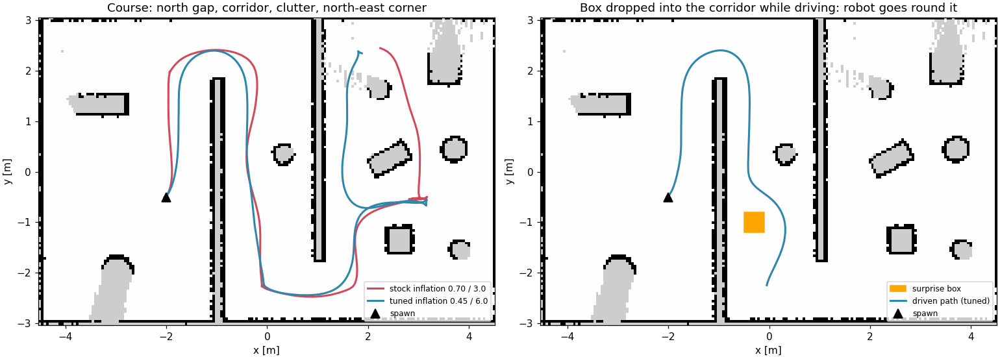

# TurtleBot3 + Nav2: custom obstacle course

A TurtleBot3 (waffle) maps and navigates a custom obstacle course in Gazebo with Nav2:
SLAM mapping, AMCL localization, avoiding an obstacle that is not on the map, and tuned costmaps.
Built on **ROS 2 Lyrical + Gazebo (gz-sim 10) on Ubuntu 26.04**.

**Demo video:** _TODO: add link_



*Left: the course route with stock vs tuned costmap inflation. Right: a box is dropped into the
corridor while the robot drives; Nav2 sees it and goes round. Paths are ground truth, drawn on the
map the robot built itself.*

## Quick start

Prerequisites: Ubuntu 26.04 with a GPU desktop session (Gazebo needs 3D acceleration).

```bash
git clone https://github.com/shadowPunch/antropi-assignment.git tb3_nav_ws
cd tb3_nav_ws
bash tools/01_install_ros.sh          # ROS 2 Lyrical desktop, Nav2, TB3 sim, SLAM, teleop (asks for sudo)
bash tools/01_check_install.sh        # talker/listener + a Gazebo window
source /opt/ros/lyrical/setup.bash
colcon build --symlink-install
source install/setup.bash
```

Run the demo (Gazebo + RViz open; the waypoint script sets the initial pose itself):

```bash
ros2 launch tb3_nav_demo nav_demo.launch.py   # terminal 1
ros2 run tb3_nav_demo waypoints.py            # terminal 2: 4 waypoints across the course
```

Or click in RViz: **2D Pose Estimate** at the robot (spawn is x=-2.0, y=-0.5, facing +x), then **Nav2 Goal**.

More:

```bash
ros2 launch tb3_nav_demo nav_demo.launch.py slam:=True                  # map with slam_toolbox instead of AMCL
ros2 run tb3_nav_demo send_goal.py 3.3 -0.6                              # initial pose + one goal (world x y)
ros2 run tb3_nav_demo run_trial.py --route corridor --surprise --out s.json   # drop a box in its path, measure
ros2 run teleop_twist_keyboard teleop_twist_keyboard --ros-args -p stamped:=true   # /cmd_vel is TwistStamped
```

All coordinates are **Gazebo world coordinates**; the saved map's frame is aligned with the world.

## What I changed from the defaults, and why

| What | Stock | Mine | Why |
| --- | --- | --- | --- |
| World | `tb3_sandbox` (hexagon + 9 pillars) | `worlds/my_world.sdf.xacro`: 9 x 6 m room, two offset walls forcing an S-route through a 1.8 m corridor with a pillar, plus a cluttered area | Corridors and clutter make the planner and costmaps do real work |
| Map | `tb3_sandbox.yaml` | `maps/my_world.{pgm,yaml}`, built with slam_toolbox by a scripted coverage drive | New world needs its own map; scripted so it can be rebuilt identically |
| Costmap inflation | radius 0.70 m, cost scaling 3.0 | **0.45 m, 6.0** (both costmaps) | ~14% faster on my course, same worst-case clearance (below) |
| Launch | `tb3_simulation_launch.py` + args | `nav_demo.launch.py` wraps it with my world, map, params and RViz layout | One command |
| RViz | `nav2_default_view.rviz` | `rviz/nav.rviz`: same displays, view centred on my room | Map, both costmaps, laser, robot, global and local plan in one view |

### Tuning results

Each setting driven twice over the same course (3 goals: north gap, corridor past the pillar,
clutter, north-east corner), headless, measured against ground truth with `run_trial.py`:

| setting | time | path | mean gap | worst gap | recoveries |
| --- | --- | --- | --- | --- | --- |
| stock 0.70 / 3.0 (MPPI) | 62.1 s | 18.2 m | 0.44 m | -0.04 m | 0 |
| **tuned 0.45 / 6.0 (MPPI), shipped** | **53.6 s** | **17.0 m** | 0.38 m | +0.00 m | 0 |
| wide 1.00 / 1.5 (MPPI) | 58.4 s | 18.0 m | 0.40 m | -0.00 m | 0.5 |
| stock costmaps, Regulated Pure Pursuit | 56.3 s | 17.4 m | 0.38 m | -0.10 m | 3.5 |

*Gap = distance between the robot's 0.22 m safety circle and the nearest obstacle. The waffle is about
0.31 m wide, so a slightly negative gap is not a collision.*

- My passages are 1.0-1.8 m wide. The stock 0.7 m inflation spreads cost across almost the whole
  passage, so the planner cannot tell the middle from the edge and MPPI's cost critic slows the robot.
  With cost concentrated near walls, the same route is driven faster.
- Wider inflation (the usual "stay in the middle" advice) bought no clearance here and caused a recovery.
- Regulated Pure Pursuit tracks the path tightly instead of optimising against the costmap: the closest
  approaches and up to 7 recoveries in one run. MPPI stays.
- Every close approach, under every setting, was in the same 0.6 m gap in the clutter.

**Obstacle not on the map:** a 0.4 m box appears on the planned path when the robot enters the corridor.
Before, the global plan ran through that spot (0.00 m from the box); after, it went round with
0.31-0.36 m to spare, in every run, with no recoveries. The box was lethal in the local costmap
~2.5-2.9 s after the spawn command. Tuned params passed it with more room (+0.07 / +0.08 m vs
-0.02 / +0.03 m) and 16% faster.

## Repository layout

```
src/tb3_nav_demo/          the ROS 2 package (ament_cmake)
  launch/nav_demo.launch.py
  worlds/my_world.sdf.xacro   room, partitions, pillar, clutter (xacro box/cylinder macros)
  maps/my_world.{pgm,yaml}
  config/nav2_params.yaml     nav2_bringup defaults + tuned inflation
  rviz/nav.rviz
  scripts/
    nav_utils.py              shared helpers around nav2_simple_commander's BasicNavigator
    send_goal.py              scripted "2D Pose Estimate" + "Nav2 Goal"
    waypoints.py              initial pose + followWaypoints() on 4 points
    explore_and_map.py        SLAM coverage drive, then saves the map
    run_trial.py              drives a route, writes a JSON report (time, clearance, recoveries, replanning)
    world_geometry.py         obstacle shapes from the world SDF, for ground-truth clearance
tools/                     scripts that reproduce each step of the assignment
  01_install_ros.sh, 01_check_install.sh
  02_run_baseline.sh       stock nav2_bringup demo + nodes/topics/TF dump
  03_run_my_world.sh       smoke test of the package (SLAM mode)
  04_map_my_world.sh       SLAM coverage drive -> save map -> AMCL check across the course
  05_experiments.sh/.py    all tuning / controller / surprise / waypoint trials, logged to Weights & Biases
  plot_trajectories.py     the figure above
  ros_env.sh, sim_lib.sh   environment setup and start/stop helpers
docs/trajectories.png
```

The step scripts write logs to `logs/` (git-ignored). `tools/05_experiments.sh` needs a venv with
`wandb` (`uv venv --python /usr/bin/python3.14 --system-site-packages .venv && uv pip install --python
.venv/bin/python wandb`), or run it with `TB3_WANDB=0` to skip W&B.

## Design decisions

- **Reuse the stock bringup.** The launch file only overrides world, map, params and the RViz layout;
  nav2_bringup's simulation launch does the rest.
- **One frame for everything.** slam_toolbox starts the `map` frame at the spawn pose. The saved map's
  origin is shifted by the spawn pose, so with AMCL `map` equals the Gazebo world frame; in SLAM mode goals
  are shifted by the spawn pose instead (`nav_utils.world_to_slam_map`).
- **Robust waiting instead of `waitUntilNav2Active()`.** Simple Commander's version waits on a lifecycle
  `get_state` reply with no timeout and hung when the first reply was lost during DDS discovery.
  `nav_utils.wait_until_active` retries with a timeout; the initial pose is re-published until AMCL
  answers; `waypoints.py` waits for `waypoint_follower` itself, which activates after `bt_navigator`.
- **Scripted mapping.** Nav2 drives a fixed coverage route through unknown space (`allow_unknown: true`).
  Each goal waits until it lies inside the growing costmap, because the planner rejects goals outside it.
- **Measured, not eyeballed, tuning.** Clearance is computed from Gazebo odometry against the obstacle
  geometry parsed from the same world file Gazebo loads, so there is one source of truth.

## Troubleshooting

- **Gazebo GUI crashes with `symbol lookup error ... /snap/core20/... libpthread.so.0`** when started from
  the VS Code terminal: VS Code installed as a snap leaks GTK/GIO paths into child processes.
  `source tools/ros_env.sh` removes them (or use a normal terminal).
- **`colcon build` fails with `No module named 'catkin_pkg'`**: CMake picked a non-system Python
  (e.g. a uv-managed one in `~/.local/bin`). Add `--cmake-args -DPython3_EXECUTABLE=/usr/bin/python3`.
- **Robot ignores teleop keys**: `/cmd_vel` is `TwistStamped`; pass `-p stamped:=true`.
- **"Goal Coordinates ... was outside bounds" in SLAM mode**: the map only covers what the lidar has seen,
  and its frame starts at the spawn pose; see `send_goal.py --slam`.
